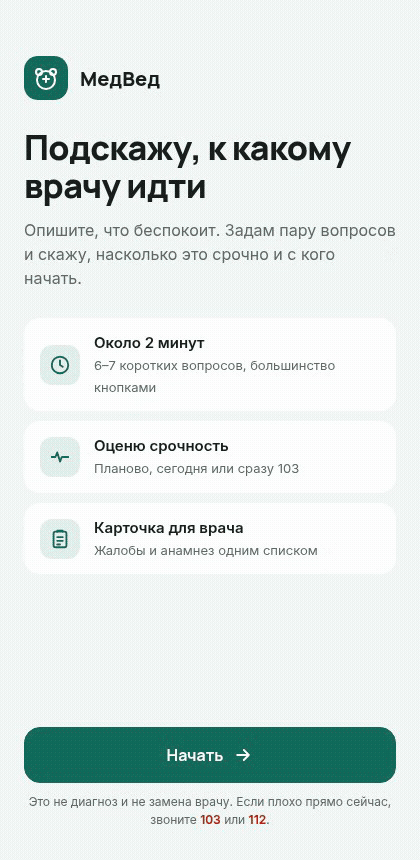

# МедВед: чат-бот первичной маршрутизации пациента

Хакатон «МедВед.Код2». Бот расспрашивает пациента о жалобах и анамнезе, оценивает срочность и подсказывает, к какому врачу идти.

## Демо

<p align="center"></p>

Два сценария в реальном темпе: боль в пояснице с температурой (итог «сегодня», терапевт → уролог) и признаки инсульта (экран вызова 103). [Видео в mp4](docs/demo.mp4). Скрипт записи: `docs/record.py` (Playwright, при запущенном сервере).

## Скачать

[**medved-bot.zip**](https://github.com/z0rkez/medved-bot/releases/latest/download/medved-bot.zip): исходники последней версии, без демо-видео. Все версии лежат в [Releases](https://github.com/z0rkez/medved-bot/releases).

Через git:

```sh
git clone https://github.com/z0rkez/medved-bot.git
```

Для запуска нужен [uv](https://docs.astral.sh/uv/getting-started/installation/): он сам поставит Python 3.14 и зависимости.

## Запуск

```sh
uv sync
uv run uvicorn app:app --port 8765   # веб-чат: http://localhost:8765
uv run pytest                        # тесты
```

## Подключение мини-аппа MAX

МедВед — это страница, которую пациент открывает внутри MAX. Для подключения нужны два адреса. Первый ведёт на **страницу бота** — его вы получите на Render. Второй ведёт на **сервер с данными пациентов** (в проекте он называется `core`) — его использует сам бот.

### 1. Получите ссылку на бота

1. Войдите в [панель Render](https://dashboard.render.com/) и нажмите **New → Web Service**.
2. Подключите GitHub, выберите репозиторий **z0rkez/medved-bot** и ветку **main**.
3. В поле **Language** выберите **Docker**. Команда запуска уже записана в проекте. Оставьте один экземпляр сервиса, чтобы все ответы пациента попадали в один диалог.
4. Для тестового сервера настройки уже готовы. Если у вас другой сервер с данными пациентов, добавьте в **Environment Variables** переменную с именем `CORE_URL`. В значение вставьте адрес сервера до первого пути, например `https://core.example.org`. По умолчанию бот обращается к `https://tm-test-yakut.hostco.ru`.
5. Нажмите **Create Web Service**. Когда сервис запустится, скопируйте его адрес вида `https://имя-сервиса.onrender.com` и откройте в браузере. Вы должны увидеть страницу МедВеда с кнопкой **«Начать»**.

Названия полей и кнопок можно сверить с [инструкцией Render](https://render.com/docs/web-services#deploy-your-own-code).

### 2. Подключите страницу к MAX

Передайте адрес бота разработчику мини-аппа. При нажатии кнопки входа мини-апп должен открыть страницу МедВеда внутри MAX и добавить к адресу одноразовый код пациента (JWT). Ссылка выглядит так:

```text
https://имя-сервиса.onrender.com/?token=КОД_ПАЦИЕНТА
```

Вместо `имя-сервиса.onrender.com` подставьте адрес из шага 1, а вместо `КОД_ПАЦИЕНТА` — свежий JWT для этого пациента. Код действителен 5 минут и используется один раз. Ссылку с кодом нужно формировать при каждом открытии.

### 3. Проверьте результат в MAX

Откройте МедВеда из мини-аппа. Бот должен поздороваться с пациентом по имени, добавить отчество, если оно есть, и спросить **«Пол пациента?»**. Это означает, что возраст уже получен.

Если бот предложил ввести возраст вручную, закройте страницу и откройте её заново из MAX со свежим кодом. Если вопрос повторится, проверьте, что мини-апп передаёт код и что с Render доступен сервер по адресу `CORE_URL`. Пациент в любом случае может продолжить опрос вручную.

### Как попробовать на своём компьютере без MAX

Здесь настоящий код пациента не нужен. В проекте есть маленький тестовый сервер, который возвращает данные вымышленной Анны Петровны.

1. Откройте терминал в папке `medved-bot`, где лежит `app.py`. Запустите тестовый сервер и оставьте этот терминал открытым.

   ```sh
   uv run uvicorn core_stub:app --app-dir tests --port 8766 --no-access-log
   ```

2. Откройте второй терминал в той же папке. Запустите бота и укажите ему адрес тестового сервера.

   ```sh
   CORE_URL=http://127.0.0.1:8766 uv run uvicorn app:app --port 8765
   ```

3. Откройте в браузере [вход с тестовым кодом](http://localhost:8765/?token=test). Должны появиться **«Здравствуйте, Анна Петровна!»** и кнопки **«Мужской»** и **«Женский»**. Для второй попытки используйте новый код, например [test-2](http://localhost:8765/?token=test-2).
4. Чтобы увидеть, что произойдёт при ошибке, откройте [ссылку с недействительным кодом](http://localhost:8765/?token=expired). Бот предложит ввести возраст. Чтобы увидеть обычный стартовый экран, откройте [страницу без кода](http://localhost:8765/).

После проверки нажмите `Ctrl+C` в каждом терминале.

<details>
<summary>Технические детали для разработчика мини-аппа</summary>

Страница сразу убирает `token` из адресной строки и вызывает `POST /api/init` с телом `{"session_id": "...", "token": "..."}`. Бэкенд один раз запрашивает `GET {CORE_URL}/api/v3/users/user-for-external-service?token=<JWT>` с заголовком `Authorization: Bearer <JWT>`. Из ответа core в сессии остаются только возраст и имя с отчеством.

Сессии хранятся в памяти одного процесса Uvicorn. Отпечатки использованных токенов (SHA-256) записываются в файл `.used-tokens.sqlite3` рядом с `app.py`. Если сервис стоит за прокси, разрешите встраивание страницы во фрейм MAX и исключите параметры запроса из журналов прокси.

</details>

## Как устроено

| Файл | Что делает |
|---|---|
| `triage/text.py` | нормализация, разбивка на клаузы, поиск шаблонов с учётом отрицаний («голова не болит») |
| `triage/knowledge.py` | специалисты, симптомы с весами, красные флаги, хронические болезни, модификаторы и сочетания |
| `triage/engine.py` | диалог (состояния), оценка срочности, маршрут, текст ответа |
| `app.py` | Вход из MAX через `POST /api/init`, диалог через `POST /api/message`, сессии в памяти |
| `static/index.html` | веб-чат с кнопками быстрых ответов |

Движок не зависит от транспорта: бот для MAX или Telegram вызывает тот же `handle(session, text)` и рисует `reply.buttons` как клавиатуру. Мессенджерам хватает `reply.text`. Веб рисует экраны по `reply.meta`: `step`/`total` для полосы прогресса, `recognized` для меток распознанных жалоб, `result` (срочность, маршрут, карточка) для экрана итога.

### Диалог

1. Возраст (можно в месяцах) и пол.
2. Жалобы свободным текстом. Красный флаг (инсульт, потеря сознания, кровотечение, отёк гортани, риск суицида) сразу даёт экстренный ответ.
3. До 3 уточняющих вопросов да/нет по найденным симптомам: «да» означает экстренную ситуацию.
4. Длительность, температура, хронические болезни, беременность (женщины 12–55 лет).
5. Итог: срочность, маршрут, карточка для врача.

### Срочность

| Уровень | Когда | Что советуем |
|---|---|---|
| Экстренно | красный флаг, «да» на уточнение, ребёнок до года с 38+ | 103 / 112 |
| Сегодня | 39+, 38+ дольше 3 дней, опасные сочетания, беременность, диабет с рвотой | врач на дом или неотложный кабинет |
| Планово | остальное | запись через Госуслуги или регистратуру |

### Маршрут

Каждый симптом даёт веса специалистам, сочетания и анамнез добавляют бонусы. Побеждает специалист с наибольшей суммой. Если к нему нужно направление, маршрут идёт через терапевта (для детей через педиатра).

## Допущения, которые стоит проверить

- Список врачей без направления: терапевт, педиатр, стоматолог, акушер-гинеколог, травмпункт.
- Телефоны: 103, 112, детский телефон доверия 8-800-2000-122.
- Веса и шаблоны подобраны вручную, медицински не валидированы. Перед защитой хорошо бы показать врачу.

## Что дальше

- Адаптер для Telegram.
- LLM как запасной разборщик жалоб, когда шаблоны ничего не нашли (правила оставить главными: так их проще объяснить жюри).
- Запись к врачу через API региональной МИС, если организаторы её дадут.
