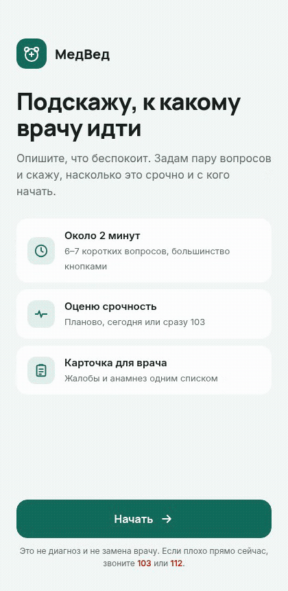

# МедВед: чат-бот первичной маршрутизации пациента

Хакатон «МедВед.Код2». Бот расспрашивает пациента о жалобах и анамнезе, оценивает срочность и подсказывает, к какому врачу идти.

## Демо

<p align="center"></p>

Два сценария в реальном темпе: боль в пояснице с температурой (итог «сегодня», терапевт → уролог) и признаки инсульта (экран вызова 103). [Видео в mp4](docs/demo.mp4). Скрипт записи: `docs/record.py` (Playwright, при запущенном сервере).

## Запуск

```sh
uv sync
uv run uvicorn app:app --port 8765   # веб-чат: http://localhost:8765
uv run pytest                        # тесты
```

## Как устроено

| Файл | Что делает |
|---|---|
| `triage/text.py` | нормализация, разбивка на клаузы, поиск шаблонов с учётом отрицаний («голова не болит») |
| `triage/knowledge.py` | специалисты, симптомы с весами, красные флаги, хронические болезни, модификаторы и сочетания |
| `triage/engine.py` | диалог (состояния), оценка срочности, маршрут, текст ответа |
| `app.py` | FastAPI: `POST /api/message`, сессии в памяти |
| `static/index.html` | веб-чат с кнопками быстрых ответов |

Движок не зависит от транспорта: бот для MAX или Telegram вызывает тот же `handle(session, text)` и рисует `reply.buttons` как клавиатуру. Мессенджерам хватает `reply.text`. Веб рисует экраны по `reply.meta`: `step`/`total` для полосы прогресса, `recognized` для меток распознанных жалоб, `result` (срочность, маршрут, карточка) для экрана итога.

### Диалог

1. Возраст (можно в месяцах) и пол.
2. Жалобы свободным текстом. Красный флаг (инсульт, потеря сознания, кровотечение, отёк гортани, риск суицида) сразу даёт экстренный ответ.
3. До 3 уточняющих вопросов да/нет по найденным симптомам: «да» означает экстренную ситуацию.
4. Длительность, температура, хронические болезни, беременность (женщины 12–55 лет).
5. Итог: срочность, маршрут, карточка для врача.

### Срочность

| Уровень | Когда | Что советуем |
|---|---|---|
| Экстренно | красный флаг, «да» на уточнение, ребёнок до года с 38+ | 103 / 112 |
| Сегодня | 39+, 38+ дольше 3 дней, опасные сочетания, беременность, диабет с рвотой | врач на дом или неотложный кабинет |
| Планово | остальное | запись через Госуслуги или регистратуру |

### Маршрут

Каждый симптом даёт веса специалистам, сочетания и анамнез добавляют бонусы. Побеждает специалист с наибольшей суммой. Если к нему нужно направление, маршрут идёт через терапевта (для детей через педиатра).

## Допущения, которые стоит проверить

- Список врачей без направления: терапевт, педиатр, стоматолог, акушер-гинеколог, травмпункт.
- Телефоны: 103, 112, детский телефон доверия 8-800-2000-122.
- Веса и шаблоны подобраны вручную, медицински не валидированы. Перед защитой хорошо бы показать врачу.

## Что дальше

- Адаптер под платформу из ТЗ (MAX / Telegram).
- LLM как запасной разборщик жалоб, когда шаблоны ничего не нашли (правила оставить главными: так их проще объяснить жюри).
- Запись к врачу через API региональной МИС, если организаторы её дадут.
